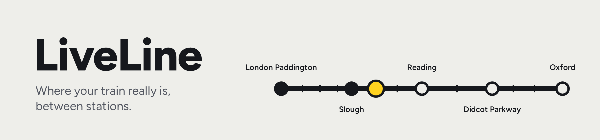
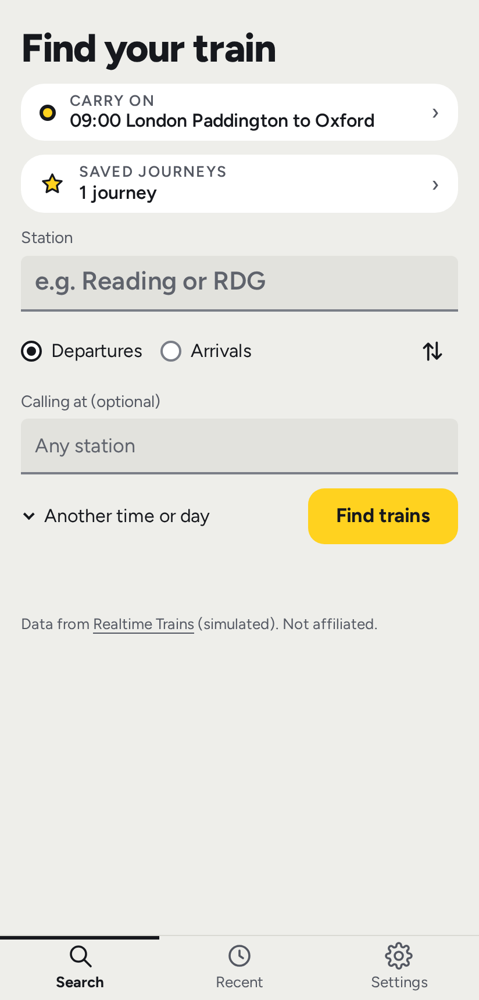
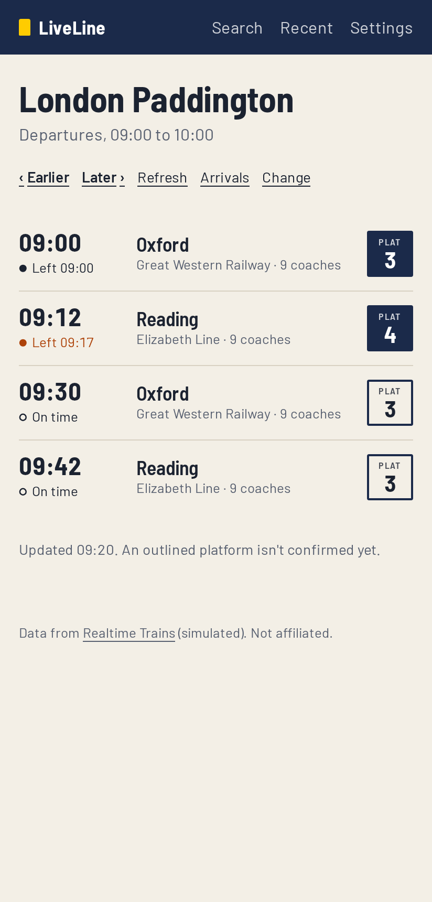
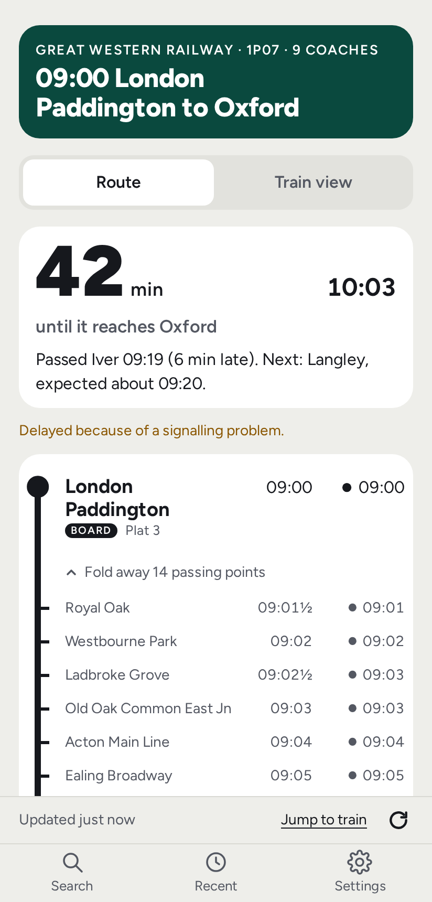
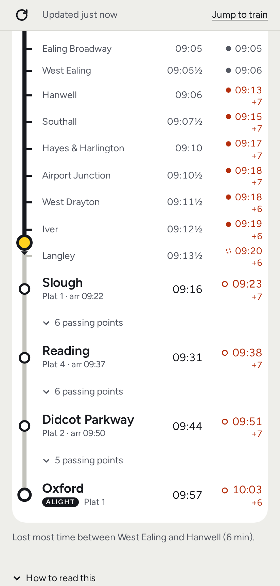

<a href="#readme">
  <picture>
    <source media="(prefers-color-scheme: light)" srcset="docs/img/banner-light.png">
    <source media="(prefers-color-scheme: dark)" srcset="docs/img/banner-dark.png">
    
  </picture>
</a>

<p align="center">
  <a href="https://github.com/dusty369289/liveline/releases/latest"></a>
  <a href="https://github.com/dusty369289/liveline/actions/workflows/ci.yml"></a>
  <a href="LICENSE"></a>
  
</p>

<p align="center">
  <a href="#get-started"><b>Get started</b></a> &nbsp;·&nbsp;
  <a href="#reading-it"><b>Reading it</b></a> &nbsp;·&nbsp;
  <a href="#how-it-works"><b>How it works</b></a> &nbsp;·&nbsp;
  <a href="#limits"><b>Limits</b></a> &nbsp;·&nbsp;
  <a href="#developing"><b>Developing</b></a>
</p>

Most train apps know a train is "between Slough and Reading". **LiveLine shows where between.**

It follows a train through every stop *and every timing point it passes*: junctions, and the stations it runs
through. Between reports it moves the train along the line at the timetable's pace, and holds it short of the next
point until that point is reported, so a train stuck at a signal looks stuck.

It's an Android app that talks to [Realtime Trains](https://www.realtimetrains.co.uk/) straight from your phone, with
your own free key. No server, no account, and without a key it runs a clearly marked demo.

<p align="center">
  <picture><source media="(prefers-color-scheme: dark)" srcset="docs/img/search-dark.png"></picture>
  <picture><source media="(prefers-color-scheme: dark)" srcset="docs/img/board-dark.png"></picture>
  <picture><source media="(prefers-color-scheme: dark)" srcset="docs/img/train-dark.png"></picture>
  <picture><source media="(prefers-color-scheme: dark)" srcset="docs/img/train-line-dark.png"></picture>
</p>
<p align="center"><sub>Search · pick a train · when it leaves · where it is. From the demo: simulated trains on a real route.</sub></p>

## What it does

- **Every timing point.** Stops, junctions and through stations, folded into "6 passing points" until you open them.
  The run the train is on opens by itself.
- **The train on the line.** Placed between its last report and the next, never past a point that hasn't reported.
- **The number you came for.** A big "42 min" until it leaves your stop, or reaches where you get off, with the
  platform. It's on the search page too, for the train you're on.
- **Honest about what it knows.** Reported, forecast and the app's own guess each look different, and simulated, stale
  or missing data says so.
- **Your journeys.** Star a board to save a commute, and flip it for the way home.
- **Made for one thumb.** On a tall phone the tabs and each page's controls sit at the bottom, within reach.
- **Gentle on your allowance.** Every call is counted, cached and paced to fit Realtime Trains' free 100 an hour.
- **Three themes, light and dark.** Operator colour (each train in its operator's colours), Swiss timetable or Quiet.
- **Updates itself.** One tap downloads the next release, checks it and installs it, keeping your key and journeys.

## Get started

1. **Install.** On your phone, open the [latest release](https://github.com/dusty369289/liveline/releases/latest),
   download the `.apk` and open it. Android asks once to allow installs from your browser.
2. **Add your key.** Sign in at <https://api-portal.rtt.io> (the API portal, not the RTT+ subscriptions page) and
   request a token: the free plan works. Paste it into **Settings**. It's checked with Realtime Trains (one call) and
   kept only on your phone, in the app's private storage, with backups off.
3. **Stay up to date.** When a new version is out, **Update now** installs it. The download is checked against its
   published SHA-256 first.

> [!NOTE]
> Without a key, LiveLine runs a **demo** on two real routes (Paddington to Oxford, Waterloo to Woking) with simulated
> trains, and a banner on every page says so. The Hobbyist plan (£4 a month) adds detailed mode, which the app uses by
> itself.

## Reading it

- **● 09:19** reported by Realtime Trains: to the minute on Free, to the quarter minute with detailed mode.
- **○ 09:23** Realtime Trains' forecast. "On time" when it matches the booking.
- **◌ 09:20** the app's own guess, only where Realtime Trains gives none, or an impossible one.
- **+7** minutes late, counted toward zero as the railway does. **09:13½** is a working-timetable time.
- <kbd>BOARD</kbd> <kbd>ALIGHT</kbd> mark where you get on and off. A **solid platform plate** is confirmed; an
  outlined one isn't yet.

## How it works

<details>
<summary><b>Where it places the train</b></summary>

Realtime Trains reports a train as it passes each timing point. Between two reports LiveLine moves the marker by the
time elapsed against the booked time for that section. It stops at 95% of the way until the next point is reported,
and if that report is 2 minutes overdue it says "No report at Langley yet" rather than pretend.

Where Realtime Trains has no forecast, LiveLine makes its own: it carries the delay forward and lets a late train win
back 75% of the recovery time and long waits in the timetable, but never leave an advertised stop early. It's a
reasoned guess, not a tested model, and it's always drawn as a dashed ring.

</details>

<details>
<summary><b>How it spends your allowance</b></summary>

Your key's allowance is 10 calls a minute, 100 an hour and 1000 a day (Free and Hobbyist). Each window rolls: a call
counts against it until it's that old. Every call goes through one budget, which also obeys the limits Realtime
Trains reports with each answer, and any "wait until" it sends.

<picture>
  <source media="(prefers-color-scheme: dark)" srcset="docs/img/allowance-call-dark.png">
  
</picture>

As the hour's calls run down, the app slows itself, so they last the hour:

<picture>
  <source media="(prefers-color-scheme: dark)" srcset="docs/img/allowance-hour-dark.png">
  
</picture>

<sub>Drawn like the app's route line by <code>npm run readme-pictures</code>, from the rules in <code>src/core/budget.ts</code> and <code>src/core/poll.ts</code>.</sub>

- A train page asks just after the next report is due, at most once a minute, and every 2 to 3 minutes while
  nothing is due, or every half hour for a train over 2 hours off. Following one train for an hour costs about 45
  calls. It stops when the train arrives, and never runs in the background.
- **Refresh** gets a new answer only when the one shown is over 15 seconds old, over 60 when the hour is running low,
  and not at all in its last 10 calls. Tapping it again costs nothing. The search page's refresh for your train waits
  a minute between calls.
- A board is one call for three hours, so **Earlier** and **Later** are usually free. A board for now refreshes
  itself every 2 minutes for 15 minutes.
- The last 10 calls of each hour are kept for searches. If the allowance runs out you see the last answer, marked as
  old, never "not found".

</details>

## Limits

- **No signals.** Realtime Trains reports timing points, not signals or track sections. Following a train signal by
  signal would need Network Rail's train describer feed, which a phone app can't use on its own.
- **Your own key** for real trains. Realtime Trains doesn't allow a key inside a published app.
- **Android only, for now.** The core is platform-free, so iOS or a desktop build could follow.
- **National Rail in Great Britain.** No Underground, trams or buses (rail replacement buses do show).

## Developing

```sh
npm ci
npm run dev        # the app at localhost:5173, demo trains until you add a key
npm run check      # types, unit tests, architecture rules, leak check, build
npm run test:ui    # every page, 360 and 412 px, light and dark: see .ui-report/
```

TypeScript, Vite and Capacitor, with plain CUBE CSS and no framework. Tests never touch the network: the unit tests
use a simulator and recordings of real Realtime Trains answers, and the browser tests fake every request.
[AGENTS.md](AGENTS.md) explains how it works, the rules the tests enforce, and how changes and releases are made.

<details>
<summary><b>Credits</b></summary>

- Train data: [Realtime Trains](https://www.realtimetrains.co.uk/). LiveLine isn't affiliated with them.
- Station list: [uk-railway-stations](https://github.com/davwheat/uk-railway-stations) by David Wheatley, from
  [Trainline EU](https://github.com/trainline-eu/stations), under the ODbL.
- Typefaces, all under the SIL Open Font License: [Figtree](public/fonts/OFL-figtree.txt) by Erik Kennedy,
  [Inter Tight](public/fonts/OFL-inter-tight.txt) by Rasmus Andersson, and
  [Atkinson Hyperlegible Next](public/fonts/OFL-atkinson-hyperlegible-next.txt) by the Braille Institute.
- Operator colours: Wikipedia's [National Rail colours](https://en.wikipedia.org/wiki/Template:National_Rail_colour),
  and the Elizabeth line's from TfL's own design idiom. Operator names and colours identify the trains; LiveLine isn't
  connected with any operator.

</details>

[MIT licence](LICENSE).
